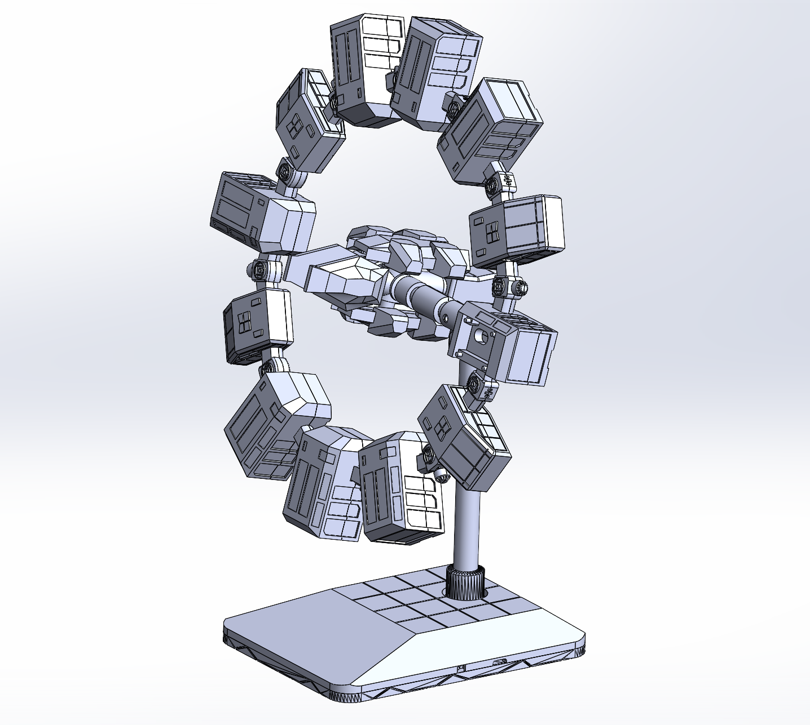

<div align="center">

# 🌌 永恒号 (Project Endurance)
### 《星际穿越》经典环形飞船 · 高精度模块化桌面机械工程

[](https://www.solidworks.com/)
[]()
[]()
[](LICENSE)

*致敬《星际穿越》(Interstellar) 经典环形太空站「永恒号」*  
*融合 12 环形外舱、中心对接轴、多功能挂载（MCU / 屏幕 / 传感器 / 触摸按键）与桌面展示底座的 3D 打印全套 CAD 方案*

---

<!-- 效果图 / 渲染图展示 -->


</div>

## 📖 项目简介 (Overview)

**“永恒号 (Endurance)”** 是基于经典科幻电影《星际穿越》中标志性环形飞船深度还原并二次工程化的**桌面级智能机械展示机构**。

本项目不仅完整还原了原作标志性的 **12 个外围环形多功能舱室** 与 **中心对接中枢**，更针对桌面智能硬件应用场景进行了工业级结构改造：将单片机主控、信息交互屏幕、环境传感器与触摸按键巧妙隐蔽在各舱体中，兼具硬核科幻美学与实际硬件交互功能。

### 🌟 核心设计特色
- **12 舱室环形重力环**：精准计算的 12 等分环形拼接拓扑，由标准大舱、标准小舱与铰链式连接件紧密互锁构成。
- **中心对接中枢与桁架系统**：包含中心大舱、中心小舱、中心支杆，高保真还原飞船核心对接与中控区。
- **智能硬件模块化隐藏挂载**：
  - **MCU 主控舱**：专用单片机挂载件，可选择“独立舱体保护”或“无舱轻量嵌入”；
  - **屏幕显示仓**：倾角适中，用于显示时间、温湿度或太空站遥测数据；
  - **传感与交互**：专用传感器与触控按键结构，支持手势或触控唤醒。
- **专属高稳定桌面展示底座**：带科幻几何地台网格纹理的上下分体底板，搭配高强度倾斜支撑立柱，视觉悬浮感拉满。
- **全方位 3D 打印优化**：所有零件倒角、拔模与配合公差均经过 FDM / 树脂成型实测适配。

---

## ⚠️ CAD 版本兼容性声明 (Compatibility)

> [!IMPORTANT]
> - **原生建模环境**：本工程原始文件使用 **SolidWorks 2025** 建立。
> - **向下不兼容警示**：SolidWorks 低版本（如 2024、2022、2020 等）**无法直接打开** `.sldprt` / `.sldasm` 文件。
> - **通用格式解决方案**：如果您使用的是更早的 SolidWorks 版本或其他 CAD 软件（如 Fusion 360、Siemens NX、PTC Creo、Inventor 或 FreeCAD），请直接打开 **[`Export_STEP/`](Export_STEP/)** 目录下的工业通用格式文件。
> - **网页 3D 在线预览**：GitHub 网页端支持原生渲染 STL，您可直接点击 **[`Export_STL/`](Export_STL/)** 目录下的文件，在浏览器内直接 3D 旋转预览模型。

---

## 📂 项目目录结构 (Repository Structure)

```text
永恒号/
├── CAD/                     # 原始 SolidWorks 2025 源工程
│   ├── Parts/               # 零件模型 (*.sldprt)
│   ├── Assemblies/          # 装配体总成 (*.sldasm) -> 永恒号装配体.SLDASM
│   └── Drawings/            # 工程图图纸 (*.slddrw)
│
├── Export_STEP/             # 通用 STEP/STP 格式（供任意 CAD 跨版本读取）
├── Export_STL/              # 单件 STL 格式（支持 GitHub 网页端 3D 旋转预览）
├── 3D_Print_3MF/            # 3D 打印专用切片模型（多色/工艺参数 3MF 库）
├── Drawings_PDF/            # 导出高清工程图 PDF（手机/电脑开箱即查尺寸）
├── Media/                   # 高清效果图、爆炸图动图与实物展示照片
│   ├── render_main.png
│   └── explosion.gif
│
├── .gitattributes           # Git LFS 大文件存储追踪配置
├── .gitignore               # SolidWorks 运行时临时垃圾与仿真缓存过滤
└── README.md                # 项目文档与技术规格说明
```

---

## 📑 物料清单 (Preliminary BOM)

### 1. 核心机械结构件（3D 打印件）
| 部件类别 | 部件名称 | 数量 | 推荐工艺/材质 | 备注 |
| :--- | :--- | :---: | :--- | :--- |
| **底盘与立柱** | 上方底板 | 1 | FDM (PLA+ / PETG) | 承载基础 |
| | 底板下方 | 1 | FDM (PETG / ABS) | 底座支撑脚 |
| | 中心柱体 / 支撑柱 | 4 | FDM (高填充) | 主受力结构 |
| **主支撑骨架** | 中心杆（前/后/左/上） | 1套 | FDM (4层墙厚) | 骨架联结 |
| **舱体结构** | 中心大舱 / 小舱 | 各1 | FDM / 光固化 | 核心电装舱 |
| | 标准大舱 / 小舱 | 各若干 | FDM | 模块扩展舱 |
| **模块挂架** | 单片机连接零件 (有舱/无舱) | 选配 | FDM | 主控挂载 |
| | 屏幕连接零件 (有舱/无舱) | 选配 | FDM | 交互面板 |
| | 传感器连接零件 (有舱/无舱) | 选配 | FDM | 感知组件 |
| | 触摸按键零件 | 选配 | FDM / 树脂 | 按钮导向 |

### 2. 标准硬件与外购件（推荐规格）
| 品名 | 规格说明 | 预估用量 | 用途 |
| :--- | :--- | :---: | :--- |
| **紧固螺钉** | M3 内六角圆柱头螺丝 (8mm - 16mm) | 若干 | 零件拼接与舱盖固定 |
| **嵌入螺母** | M3 热熔黄铜滚花螺母 (OD 4.2mm, L 4mm) | 若干 | 热熔植入 3D 打印孔中提供金属螺纹 |
| **主控芯片** | 单片机开发板 (尺寸适配单片机零件) | 1 | 系统运算核心 |
| **显示模组** | 液晶/OLED 屏幕模组 | 1 | 状态回显 |
| **传感器组** | 温湿度/激光测距/环境光传感器 | 选配 | 外部环境监测 |

---

## 🖨️ 3D 打印与加工建议 (Manufacturing Guidelines)

- **推荐材质**：首选 **PETG** 或 **PLA+**（若需耐热/耐候环境，推荐使用 **ABS / ASA** 或 **PA-CF 碳纤维尼龙**）。
- **层高设置**：
  - 结构件 / 承重件：`0.20 mm`
  - 配合件 / 舱室盖板：`0.16 mm`（获得更佳的表面光洁度与卡扣配合公差）
- **外圈与填充**：
  - 外壁圈数 (Wall Loops)：建议 **≥ 4 层**
  - 填充率 (Infill)：建议 **25% ~ 40%**，推荐使用 **陀螺线 (Gyroid)** 模式以提供各向同性抗撕裂强度。
- **公差预留**：设计配合公差预留约为 `0.15mm ~ 0.2mm`。如遇紧固配合较松或较紧，请根据切片机“孔洞水平扩展 / 外轮廓补偿”进行微调。

---

## 📥 源码获取与克隆指引 (Clone with Git LFS)

本仓库使用了 **Git LFS (Large File Storage)** 存储三维二进制模型与图纸。为防止拉取下来的模型变成几 KB 的指针文件，**克隆前请务必确认已安装 Git LFS**：

```bash
# 1. 检查并安装 Git LFS 扩展
git lfs install

# 2. 克隆本仓库
git clone https://github.com/Orion-shieh/Endurance.git

# 3. 若发现大文件未自动下载，可手动拉取
cd Endurance
git lfs pull
```

---

## 📜 开源许可协议 (License)

本项目采用 [Creative Commons Attribution-NonCommercial-ShareAlike 4.0 (CC BY-NC-SA 4.0)](https://creativecommons.org/licenses/by-nc-sa/4.0/) 协议开源。
- 允许自由分享、修改与衍生设计；
- 需注明原作者出处；
- **非商业性使用**；若需商业授权请联系项目作者。
